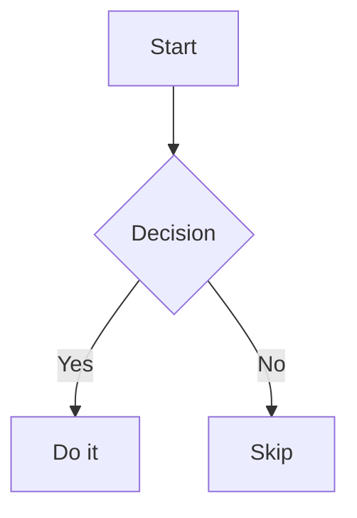

# rspress-plugin-mermaid-js

[](https://www.npmjs.com/package/rspress-plugin-mermaid-js)

An [rspress](https://rspress.rs) plugin that renders Mermaid diagrams as interactive SVGs — pan, zoom, and fullscreen support, with automatic light/dark theme switching.

Unlike static-image plugins, this renders Mermaid directly in the browser so you can navigate large, complex diagrams without losing detail.

## Install

```bash
npm install rspress-plugin-mermaid-js
# or
pnpm add rspress-plugin-mermaid-js
```

## Usage

```ts
// rspress.config.ts
import { defineConfig } from '@rspress/core';
import { pluginMermaid } from 'rspress-plugin-mermaid-js';

export default defineConfig({
  plugins: [pluginMermaid()],
});
```

Then use `mermaid` code blocks in any `.md` or `.mdx` file:

````md

````

## Options

| Option          | Type                                                                     | Default  | Description                                           |
| --------------- | ------------------------------------------------------------------------ | -------- | ----------------------------------------------------- |
| `height`        | `number`                                                                 | `480`    | Diagram container height in pixels                    |
| `root`          | `string`                                                                 | page dir | Directory that `file=` paths resolve against          |
| `mermaidConfig` | [`MermaidConfig`](https://mermaid.js.org/config/schema-docs/config.html) | `{}`     | Mermaid configuration options passed to every diagram |

```ts
pluginMermaid({
  height: 600,
  mermaidConfig: { theme: 'forest' },
});
```

## Include a diagram from a file

Add `file=<path>` to the code fence to render the diagram from a file instead of the block's text. One `.mmd` file can then be the single source for a diagram.

````md
```mermaid file=diagrams/architecture.mmd

```
````

A relative path resolves against the `root` option when you set it, and against the page's own directory when you do not:

```ts
pluginMermaid({ root: path.join(__dirname, 'docs') });
```

With that config, `file=diagrams/architecture.mmd` reads `docs/diagrams/architecture.mmd` from any page. Blocks without `file=` render as before.

The build stops with a message that names the page and the path when:

- the file does not exist,
- the path resolves outside `root` (or outside the page's directory when `root` is not set),
- the block has both `file=` and diagram text.

## Features

- **Pan** — drag to move around the diagram
- **Zoom** — ⌘/Ctrl + scroll, or use the toolbar buttons
- **Fullscreen** — toggle for maximum diagram space
- **Reset** — one click to restore the original view
- **Light/dark theme** — automatically follows the rspress theme
- **Error display** — shows the error message and raw code on render failure

## Contributing

1. [Fork the repo](https://github.com/ejhayes/rspress-plugin-mermaid-js/fork)
2. Install and verify everything passes:
   ```bash
   pnpm install
   pnpm check
   ```
3. Open a PR against `main`

## License

MIT
